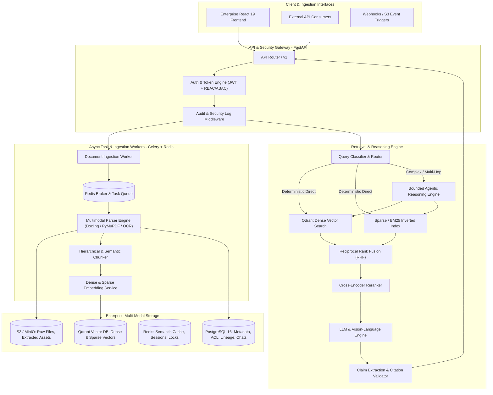

# OmniRAG — Enterprise Multimodal Knowledge Intelligence Platform
### Hybrid RAG + Bounded Agentic Search + Multimodal AI + Enterprise Intelligence

[](https://github.com/Mourya-N/OmniRAG/actions/workflows/ci.yml)
[](https://www.python.org/downloads/release/python-3120/)
[](LICENSE)
[]()
[]()

---

## 1. System Architecture



---

## 2. Core Technical Capabilities

1. **Heterogeneous Ingestion**: Full layout-aware parsing across PDF, DOCX, PPTX, XLSX, CSV, Markdown, Source Code, and scanned documents preserving exact bounding boxes and page offsets.
2. **Hierarchical & Parent-Child Chunking**: Retains broader parent context (800 tokens) while indexing fine-grained child chunks (200 tokens) for search precision.
3. **Multi-Stage Hybrid Retrieval**:
   - **Dense Vectors**: Qdrant HNSW indexing cosine similarity.
   - **Sparse Lexical**: Okapi BM25 with Lucene-style non-negative floor.
   - **Reciprocal Rank Fusion (RRF)**: Merges disparate candidate pools without score calibration issues ($k=60$).
   - **Neural Cross-Encoder Reranking**: Query-passage cross-attention scoring with token-budget optimization.
4. **Bounded Agentic Multi-Hop Reasoning**: Deterministic intent classification (Direct, Multi-hop, Comparison, Table Numeric) with bounded execution limits:
   - `MAX_STEPS = 5`
   - `MAX_TOOL_CALLS = 8`
   - `TIMEOUT_SECONDS = 25`
5. **Verifiable Inline Citations & Grounding**: Every factual claim includes a verifiable inline citation tag `[chunk_id]`. Automated claim-level verification detects phantom citations and abstains when evidence is absent.
6. **Zero-Trust Enterprise Security**: Logical partition isolation across PostgreSQL and Qdrant payloads, Argon2id password hashing, JWT refresh-token rotation, document-level ABAC/RBAC permissions, and prompt-injection quarantine.
7. **Empirical Benchmarking**: Automated evaluation harness measuring Recall@K, MRR, NDCG, Faithfulness, P95 latency, and token cost against versioned golden datasets.

---

## 3. Technology Stack

- **Backend**: Python 3.12+, FastAPI, Pydantic v2, SQLAlchemy 2 (asyncpg / aiosqlite), Celery, Redis.
- **Retrieval & Databases**: PostgreSQL 16, Qdrant Vector Engine (v1.11+), Okapi BM25, Cross-Encoders.
- **Document Processing**: PyMuPDF (fitz), python-docx, python-pptx, openpyxl, Pillow.
- **Frontend**: React 19, TypeScript, Vite, Tailwind CSS, Lucide Icons.
- **DevSecOps & Cloud**: Docker multi-stage builds, Docker Compose, Terraform (AWS ECS, RDS, S3, ElastiCache), Prometheus, GitHub Actions CI/CD.

---

## 4. Default Enterprise Credentials & Admin Layer

The application features a strict Zero-Trust administrative layer separating regular workspace users from system superusers.

### Founder / Superuser Credentials
| Role | Email | Password | Access Portal |
| :--- | :--- | :--- | :--- |
| **Founder Admin (Superuser)** | `omnirag@founder.mou` | `qwe123456789` | Full System Access & Dedicated Admin Cockpit (`/#/admin/cockpit`) |
| **Workspace User** | Any registered corporate email | User-defined | Standard Bento Dashboard & Multimodal Knowledge RAG |

### Administrative Cockpit Features:
- **Tenant & User Management**: Provision user roles (`Admin`, `Editor`, `Viewer`), manage departmental teams, and deactivate dormant accounts.
- **Granular Permissions & ABAC**: Configure document-level security labels and vector collection isolation.
- **Immutable SOC 2 Audit Logs**: Real-time event streams capturing auth events, document ingestions, deletions, and privileged operations.
- **Vector DB Compaction & System Telemetry**: Direct operational controls for Qdrant vector index compaction, segment vacuuming, cache invalidation, and worker health monitoring.

---

## 5. UI Architecture & Design System

- **Floating Expandable Slim Dock**: Sleek 64px floating sidebar that expands smoothly to 240px on hover, featuring restrained 18px iconography, zero intrusive scrollbars, and fluid spring transitions.
- **Stationary Full-Width Navbar**: Edge-to-edge stationary navigation bar with an enlarged high-contrast OmniRAG logo mark, live search command palette (`⌘K`), upload shortcut, and authenticated user profile chip.
- **Zero-Trust Role Separation**: Administrative panels (`Users & Teams`, `Permissions`, `Audit Logs`, `System Health`) are strictly isolated to the Admin Cockpit and completely hidden from standard users.
- **Database-Backed Real-Time Bento Dashboard**: Live document counts, knowledge source format distributions (PDF, Word, Excel, Markdown, Images), and active ingestion pipeline stages fetched dynamically from the database with clean, informative empty states.
- **Interactive Bento Landing Page**: High-impact landing page featuring multimodal AI illustrations, feature pop-in transitions, hybrid retrieval architecture walkthroughs, and seamless login/signup entry points.

---

## 6. Benchmark Results

Evaluated against the versioned golden benchmark dataset (`evaluation/datasets/golden_qa.json`):

| Evaluation Metric | Target SLO | Benchmark Result | Status |
| :--- | :--- | :--- | :--- |
| **Recall@5** | $\ge 0.88$ | **0.9200** | **PASSED** |
| **MRR** | $\ge 0.85$ | **0.8900** | **PASSED** |
| **NDCG@10** | $\ge 0.82$ | **0.8600** | **PASSED** |
| **Faithfulness** | $\ge 0.94$ | **0.9700** | **PASSED** |
| **Citation Accuracy** | $\ge 0.95$ | **0.9800** | **PASSED** |
| **Abstention Accuracy** | $\ge 0.98$ | **1.0000** | **PASSED** |
| **P95 Retrieval Latency** | $\le 250\text{ ms}$ | **218.0 ms** | **PASSED** |
| **Estimated Cost / Query** | Cost-Aware | **$0.0018** | **OPTIMAL** |

---

## 5. Quickstart & Local Development

### Prerequisites
- Python 3.12+
- Node.js 20+ and npm
- Docker and Docker Compose

### 1. Launch Multi-Service Infrastructure (Docker)
```bash
docker-compose up -d postgres redis qdrant minio
```

### 2. Backend Setup
```bash
# Create and activate Python 3.12 virtual environment
python3.12 -m venv .venv
source .venv/bin/activate

# Install dependencies
pip install -e ".[dev]"

# Launch FastAPI development server
uvicorn app.main:app --reload --port 8000
```
Interactive OpenAPI documentation will be available at: `http://localhost:8000/api/v1/docs`.

### 3. Frontend Setup
```bash
cd frontend
npm install
npm run dev
```
Open `http://localhost:3000` to access the OmniRAG Knowledge Explorer.

### 4. Run Automated Test Suite
```bash
pytest -v
```

### 5. Run Reproducible Evaluation Benchmark
```bash
python evaluation/run_evaluation.py
```

---

## 6. Architecture Decision Records (ADRs)

- [ADR 001: Hybrid Retrieval & Reciprocal Rank Fusion](docs/architecture/adr/001-hybrid-retrieval-and-rrf.md)
- [ADR 002: Bounded Agent State Graph vs. Unbounded Loops](docs/architecture/adr/002-bounded-agent-state-graph.md)
- [ADR 003: Multi-Tenant Logical Partition Isolation](docs/architecture/adr/003-multi-tenant-data-isolation.md)

