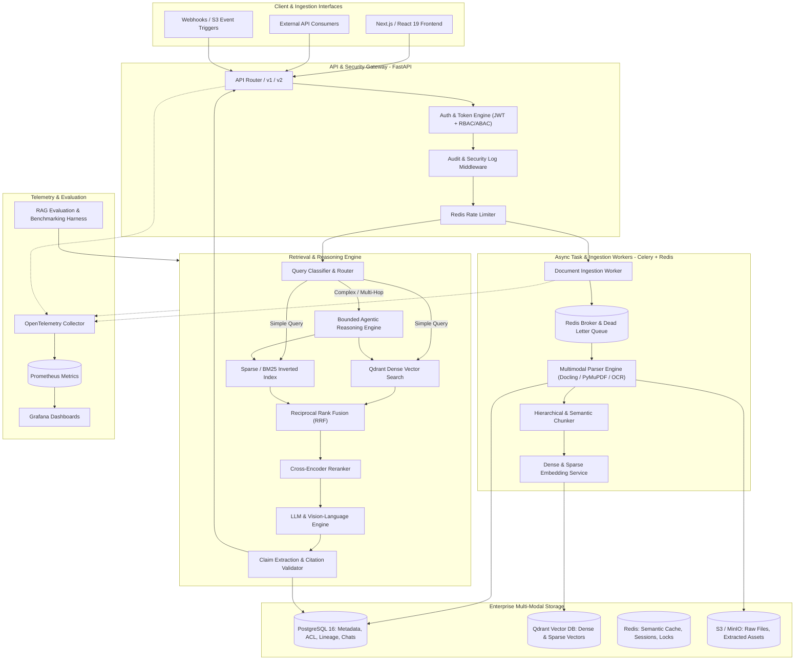
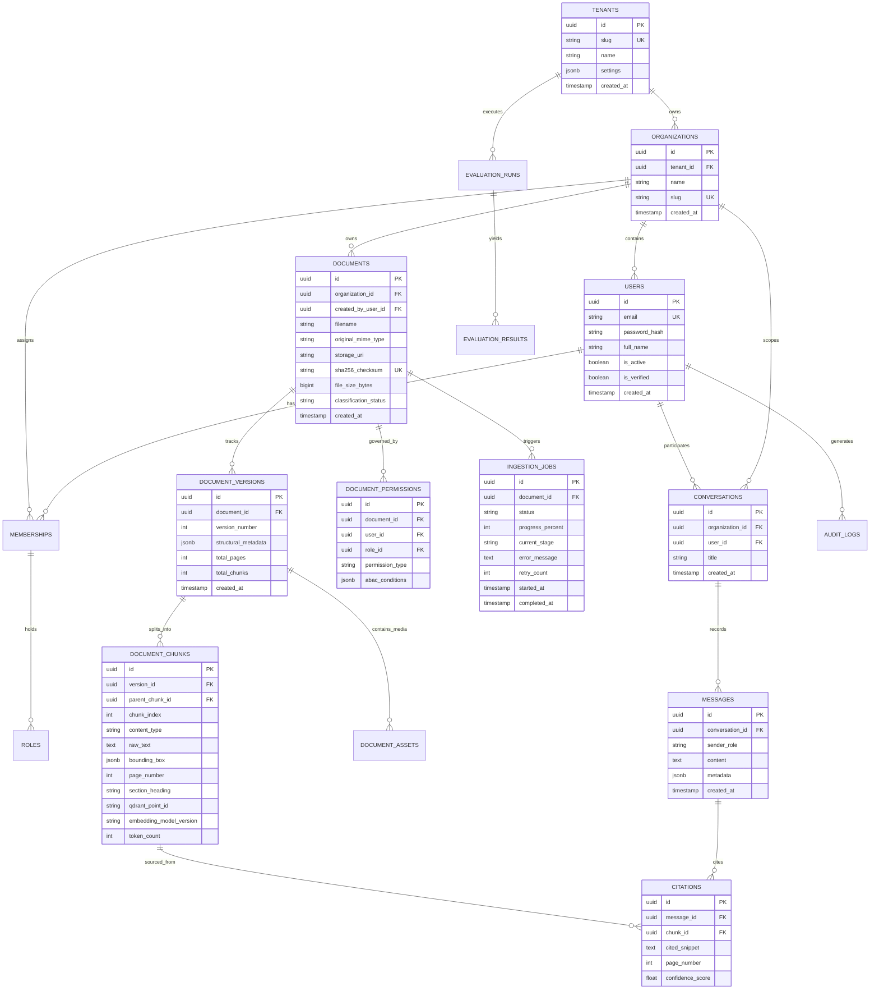
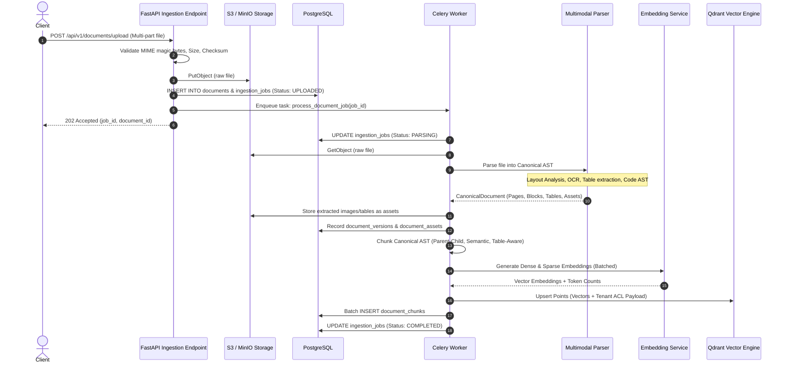
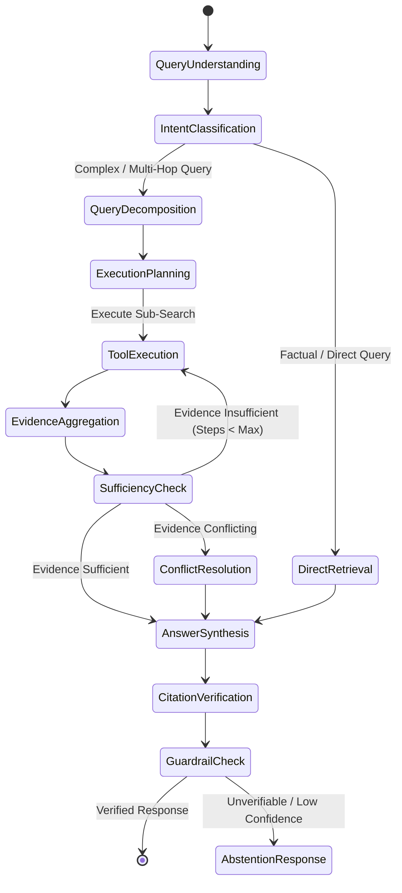

# OmniRAG — Enterprise Multimodal Knowledge Intelligence Platform
## Complete Master Architecture & System Design Document (v1.0.0)

---

### Executive Summary

**OmniRAG** is an enterprise-grade multimodal knowledge intelligence platform engineered to ingest, understand, index, retrieve, reason over, and synthesize evidence-grounded intelligence from heterogeneous enterprise information sources (PDF, DOCX, PPTX, XLSX, CSV, scanned paper, source code, images, audio/video transcripts, and structured databases).

The system is architecturally designed around six core pillars:
1. **Production Rigor**: Modular monolith design with clear bounded contexts, asynchronous distributed task processing, strict typing via Pydantic v2 and Python 3.12+, zero hardcoded secrets, and complete schema migrations via Alembic.
2. **True Multimodal Grounding**: Canonical multi-modal document representation preserving exact bounding boxes, page offsets, hierarchical structure, tables, and visual evidence (charts, diagrams, figures).
3. **Hybrid & Multi-Stage Retrieval**: Dense vector search (Qdrant) combined with sparse BM25 retrieval, reciprocal rank fusion (RRF), cross-encoder neural reranking, and document-level security filtering before LLM exposure.
4. **Bounded Agentic Orchestration**: Deterministic fast-path retrieval for factual queries and a state-machine driven multi-agent reasoning graph (Decomposition, Multi-hop traversal, Verification, Abstention) with strict token and step budgets.
5. **Zero-Trust Enterprise Security**: Multi-tenant isolation, Role-Based & Attribute-Based Access Control (RBAC/ABAC), document ACL enforcement in vector and database queries, prompt-injection defense, and tamper-proof audit trails.
6. **Continuous Observability & Reproducible Evaluation**: OpenTelemetry distributed tracing, Prometheus telemetry, structured correlation logs, and an automated evaluation harness measuring RAG Triad (faithfulness, answer relevance, context precision), Recall@K, MRR, latency, and cost per query.

---

## 1. System Architecture Overview



---

## 2. Service Boundaries & Bounded Contexts

The architecture follows a **Modular Monolith** pattern. All services share a unified domain model and database migrations initially, but are separated into clean hexagonal boundaries so that compute-heavy workers can scale horizontally on container orchestration platforms (ECS/EKS/Docker Swarm).

| Bounded Context | Responsibility | Key Interfaces & Dependencies |
| :--- | :--- | :--- |
| **Identity & Access Management (IAM)** | Authentication, refresh-token rotation, organization & tenant isolation, RBAC/ABAC evaluation, API key management. | PostgreSQL, Redis, Argon2id, JWT. |
| **Ingestion & Storage Core** | Multi-format file ingestion, MIME validation, SHA-256 deduplication, S3/MinIO presigned storage, canonical asset extraction. | S3/MinIO, PostgreSQL, Celery. |
| **Multimodal Document Parser** | Layout analysis, PDF/Docx/PPTX decomposition, OCR (PaddleOCR/Tesseract), table structure parsing, AST code analysis. | Docling, PyMuPDF, Tree-sitter, Pillow. |
| **Chunking & Representation** | Hierarchical, parent-child, semantic, and table/code-aware chunking preserving bounding boxes and page offsets. | Pydantic Canonical Document Schema. |
| **Embedding Engine** | Multi-provider dense (text-embedding-3-large, BGE-M3) and sparse (BM25/SPLADE) vector generation with retries, caching, and dimension enforcement. | OpenAI, Cohere, HuggingFace, Redis. |
| **Hybrid Indexing & Retrieval** | Dual retrieval across dense vectors (Qdrant) and lexical indexes (BM25/PostgreSQL full-text), RRF fusion, tenant/ACL pre-filtering. | Qdrant, BM25, PostgreSQL. |
| **Neural Reranking & Context Assembly** | Cross-encoder relevance scoring (bge-reranker-large), token budget management, diversity filtering, parent chunk expansion. | FlashRank / HuggingFace Transformers. |
| **Agentic Query Orchestrator** | Intent classification, query rewriting, sub-query decomposition, multi-hop search planning, tool execution with bounded execution limits. | LangGraph / Native StateGraph, LLMs. |
| **Evidence & Generation Engine** | Grounded answer generation, verbatim citation placement, conflict resolution, abstention logic. | LiteLLM / Provider Abstractions. |
| **Hallucination Detection & Verification** | Claim extraction, NLI-based premise checking, citation validity verification, faithfulness scoring. | Cross-encoders / Fast Verifier LLMs. |
| **Conversation & Memory** | Multi-turn dialog context, session management, summarized long-term user memory with tenant ACL bounds. | PostgreSQL, Redis. |
| **Evaluation & Telemetry** | RAG triad evaluation, retrieval precision/recall benchmarking, OpenTelemetry tracing, Prometheus metrics export. | OTel, Prometheus, Ragas / Custom Eval. |

---

## 3. Database & Data Architecture

### Relational Schema (PostgreSQL 16)
The relational schema provides complete transactional consistency, document-level security rules, and audit logging.



### Storage Triad Mapping
Every ingested item maintains absolute synchronization across the storage triad:
1. **Raw Object Store (S3/MinIO)**: Immutable original file (`s3://tenant-bucket/{tenant_id}/{doc_id}/raw.{ext}`) and extracted assets (`s3://.../{doc_id}/assets/{asset_id}.png`).
2. **Relational Database (PostgreSQL)**: Document metadata, canonical hierarchical AST, page numbers, ACL permissions, ingestion job status, audit logs.
3. **Vector Database (Qdrant)**: High-dimensional dense vectors (e.g., 1536-dim or 1024-dim) and sparse BM25 payload vectors. Every point payload in Qdrant contains:
   - `tenant_id` (Indexed keyword for strict partition isolation)
   - `organization_id` (Indexed keyword)
   - `document_id` (Indexed keyword)
   - `version_id` (Indexed keyword)
   - `chunk_id` (UUID mapping back to `document_chunks.id`)
   - `page_number` (Integer)
   - `content_type` (e.g., `text`, `table`, `image_caption`, `code`)
   - `acl_allowed_roles` (Array of role strings for vector-level pre-filtering)

---

## 4. Ingestion & Multimodal Parsing Pipeline

The document ingestion lifecycle moves through deterministic, restartable, and idempotent states:
`UPLOADED` $\rightarrow$ `VALIDATING` $\rightarrow$ `PARSING` $\rightarrow$ `EXTRACTING` $\rightarrow$ `CHUNKING` $\rightarrow$ `EMBEDDING` $\rightarrow$ `INDEXING` $\rightarrow$ `COMPLETED` (or `FAILED` / `RETRYING`).



---

## 5. Advanced Hybrid Retrieval & Neural Reranking Architecture

To guarantee superior Recall@K and Precision@K, OmniRAG combines dense semantic similarity and lexical keyword precision using **Reciprocal Rank Fusion (RRF)** followed by a **Cross-Encoder Neural Reranker**:

$$\text{RRF\_Score}(d \in D) = \sum_{m \in M} \frac{w_m}{k + \text{rank}_m(d)}$$

Where:
- $M = \{\text{Dense Vector Search}, \text{BM25 Lexical Search}\}$
- $k = 60$ (smoothing constant preventing high-rank dominance)
- $w_m$ is the modality weight (default $1.0$)

```mermaid
flowchart LR
    UserQuery["User Query + Tenant Context"] --> QueryClassifier["Query Classifier & Router"]
    
    subgraph MultiStageRetrieval ["Stage 1: Multi-Stage Hybrid Candidate Retrieval"]
        direction TB
        QueryClassifier -->|Dense Vector| DenseRetrieval["Qdrant HNSW Search (Filter: tenant_id & ACL)"]
        QueryClassifier -->|Sparse / Lexical| BM25Retrieval["BM25 / Sparse Index (Filter: tenant_id & ACL)"]
    end

    DenseRetrieval --> TopKDense["Top-K Dense Candidates (K=50)"]
    BM25Retrieval --> TopKSparse["Top-K Sparse Candidates (K=50)"]

    TopKDense & TopKSparse --> RRFModule["Reciprocal Rank Fusion (RRF Score Calculation)"]
    RRFModule --> TopCandidateList["Merged Candidate Pool (Top 30)"]

    subgraph Stage2Rerank ["Stage 2: Cross-Encoder Reranking & Context Selection"]
        direction TB
        TopCandidateList --> CrossEncoder["Cross-Encoder Reranker (Query-Doc Deep Cross-Attention)"]
        CrossEncoder --> RelevanceScores["Normalized Relevance Scoring"]
        RelevanceScores --> ContextSelector["Token-Budget Aware Context Selector"]
        ContextSelector --> ParentExpander["Parent Chunk Context Expansion"]
    end

    ParentExpander --> GroundedContext["Final Grounded Prompt Context + Citations"]
```



---

## 6. Agentic Search & Multi-Hop Reasoning Engine

When queries involve multi-part comparisons, temporal analysis, conflicting sources, or table synthesis, the **Agentic Search Orchestration Graph** takes over.



### Bounded Execution Guarantees
- `MAX_AGENT_STEPS = 5`
- `MAX_TOOL_CALLS = 8`
- `MAX_EXECUTION_TIME_SECONDS = 25`
- `MAX_TOKEN_BUDGET = 16,000`

---

## 7. Enterprise Security, Multi-Tenancy & Authorization Model

Security is implemented with defense-in-depth:
1. **Tenant Isolation**: Every database row and vector point is indexed by `tenant_id`. Queries without an authenticated `tenant_id` context fail at the database driver level.
2. **Two-Stage Authorization Barrier**:
   - **Pre-Retrieval Filter**: Qdrant search queries include an enforced filter matching the user's role and assigned document permissions.
   - **Post-Retrieval Verification**: Before any document text is formatted into the LLM context, the retrieval service verifies document ACLs against PostgreSQL in-memory session caches to eliminate race conditions.
3. **Data Protection**:
   - AES-256 at rest (S3 bucket policies, Postgres TDE, Qdrant disk encryption).
   - TLS 1.3 in transit.
   - Argon2id password hashing with unique per-user salts.
   - JWT tokens with short expiry (15 minutes) and cryptographically bound refresh tokens stored in Redis with revocation capability.
4. **Prompt Injection & Untrusted Data Quarantine**: Retrieved documents and web contents are treated strictly as untrusted text wrapped in clear delimiter tags (`<document_evidence id="...">`) with instruction injection defenses.

---

## 8. Complete Project Repository Structure

```
OmniRAG/
├── .github/
│   └── workflows/
│       ├── ci.yml                 # Automated testing, linting, type-checking
│       └── cd.yml                 # Docker build, container scanning & deployment
├── app/
│   ├── __init__.py
│   ├── main.py                    # FastAPI application initialization & lifespan
│   ├── core/
│   │   ├── config.py              # Pydantic v2 Settings & environment parsing
│   │   ├── database.py            # Async SQLAlchemy engine & session factory
│   │   ├── redis.py               # Redis client connection pool & cache helpers
│   │   ├── security.py            # JWT, Argon2id, RBAC & ABAC evaluators
│   │   ├── logging.py             # Structured JSON logging & correlation IDs
│   │   ├── telemetry.py           # OpenTelemetry instrumentation setup
│   │   └── exceptions.py          # Domain-specific exception hierarchy
│   ├── models/                    # SQLAlchemy 2.0 ORM Declarative Models
│   │   ├── __init__.py
│   │   ├── tenant.py
│   │   ├── user.py
│   │   ├── document.py
│   │   ├── chunk.py
│   │   ├── job.py
│   │   ├── conversation.py
│   │   ├── evaluation.py
│   │   └── audit.py
│   ├── schemas/                   # Pydantic v2 Request/Response validation models
│   │   ├── auth.py
│   │   ├── document.py
│   │   ├── retrieval.py
│   │   ├── rag.py
│   │   ├── agent.py
│   │   └── evaluation.py
│   ├── api/                       # API Route Controllers (v1)
│   │   ├── v1/
│   │   │   ├── auth.py
│   │   │   ├── organizations.py
│   │   │   ├── documents.py
│   │   │   ├── search.py
│   │   │   ├── rag.py
│   │   │   ├── agent.py
│   │   │   ├── evaluation.py
│   │   │   └── system.py
│   │   └── deps.py                # FastAPI dependency injection (Auth, DB, ACL)
│   ├── services/                  # Business Logic & Core Domain Services
│   │   ├── ingestion/             # Document Ingestion, MIME, Deduplication
│   │   ├── parser/                # Layout analysis, PDF/Docx/Code/OCR parsers
│   │   ├── chunking/              # Hierarchical, parent-child, semantic chunkers
│   │   ├── embeddings/            # Dense & sparse vector embedding providers
│   │   ├── vector_store/          # Qdrant client, collection mgmt, vector search
│   │   ├── retrieval/             # BM25, hybrid search, RRF fusion engine
│   │   ├── reranking/             # Cross-encoder neural rerankers
│   │   ├── agent/                 # Agentic search graph & query intelligence
│   │   ├── generation/            # Evidence-grounded generation & LLM caller
│   │   ├── verification/          # Hallucination detector & citation validator
│   │   └── memory/                # Conversation history & long-term user memory
│   └── workers/                   # Asynchronous Distributed Workers (Celery)
│       ├── celery_app.py
│       ├── tasks_ingestion.py
│       └── tasks_indexing.py
├── frontend/                      # Enterprise React 19 + TypeScript + Vite UI
│   ├── src/
│   │   ├── components/            # UI components (Upload, Explorer, Chat, Citations)
│   │   ├── hooks/                 # React hooks for SSE streaming & API state
│   │   ├── pages/                 # Dashboard, Documents, Chat, Admin, Evals
│   │   ├── services/              # Axios/Fetch API client bindings
│   │   └── types/                 # TypeScript interfaces matching Pydantic schemas
│   ├── package.json
│   ├── tailwind.config.js
│   └── vite.config.ts
├── tests/
│   ├── unit/                      # Fast isolated unit tests (Chunking, RRF, ACL)
│   ├── integration/               # Database, Qdrant, Redis, API integration tests
│   ├── security/                  # IDOR, tenant leakage, injection tests
│   └── performance/               # Latency, concurrent ingestion benchmarks
├── evaluation/
│   ├── datasets/                  # Golden QA benchmark sets (Simple, Multi-hop, etc.)
│   ├── synthetic_generator.py    # Synthetic question & evidence generator
│   └── run_evaluation.py          # Automated evaluation runner & metric reporter
├── migrations/                    # Alembic Database Migrations
│   ├── env.py
│   └── versions/
├── monitoring/                    # Observability definitions
│   ├── prometheus.yml
│   └── grafana/
│       └── dashboards/
├── infrastructure/                # Infrastructure as Code (Terraform)
│   ├── aws/
│   └── local/
├── docs/                          # Comprehensive technical documentation
│   ├── architecture/
│   │   ├── system_design.md
│   │   └── adr/                   # Architecture Decision Records
│   ├── api/
│   └── operations/
├── docker-compose.yml             # Full-stack local development environment
├── Dockerfile.backend             # Production multi-stage Docker build
├── Dockerfile.worker              # Worker image definition
├── pyproject.toml                 # Pinned dependencies & tooling config (Ruff, pytest)
└── README.md                      # Complete setup, architecture, and operation guide
```

---

## 9. Evaluation Strategy & Metrics

To prevent subjective assessments and fabricated numbers, OmniRAG embeds an automated, reproducible evaluation pipeline executing against versioned golden test sets:

| Dimension | Metric | Definition | Target SLO |
| :--- | :--- | :--- | :--- |
| **Retrieval Quality** | **Recall@K** | Ratio of relevant gold passages retrieved in top $K$ results. | $\ge 0.88$ (at $K=5$) |
| | **NDCG@10** | Normalized Discounted Cumulative Gain accounting for position. | $\ge 0.82$ |
| | **MRR** | Mean Reciprocal Rank of the first relevant chunk. | $\ge 0.85$ |
| **Generation Quality** | **Faithfulness** | Ratio of generated claims directly supported by retrieved evidence. | $\ge 0.94$ |
| | **Answer Relevance** | Semantic alignment between the user's question and generated response. | $\ge 0.90$ |
| | **Citation Precision** | Ratio of inline citations that accurately support the exact claim text. | $\ge 0.95$ |
| | **Abstention Accuracy** | System correctly states it lacks evidence when answers are absent. | $\ge 0.98$ |
| **System Performance** | **Retrieval P95** | Time to execute hybrid search, RRF fusion, and cross-encoder rerank. | $\le 250\text{ ms}$ |
| | **End-to-End P95** | Full RAG generation time including first token time (streaming). | $\le 1.8\text{ s}$ |
| | **Ingestion Throughput** | Multi-page PDF parsing, chunking, embedding, and indexing. | $\ge 20\text{ pages/sec/worker}$ |

---

## 10. Implementation Roadmap (Phases 1 — 22)

Every phase includes architectural implementation, unit & integration tests, documentation, and explicit verification criteria before proceeding.

- [x] **PHASE 1**: Repository inspection, system architecture, database schema, and project blueprints.
- [ ] **PHASE 2**: Project foundation, Python 3.12+ configuration, Docker Compose, core logging, and settings.
- [ ] **PHASE 3**: Authentication, Multi-tenant Organization management, RBAC/ABAC engine, and JWT security.
- [ ] **PHASE 4**: Document upload engine, MIME validation, SHA-256 deduplication, and S3/MinIO object storage.
- [ ] **PHASE 5**: Asynchronous ingestion worker pipeline (Celery + Redis), state machine, and error dead-lettering.
- [ ] **PHASE 6**: Multimodal document parsing engine (PDF, DOCX, PPTX, XLSX, CSV, Markdown, Code AST).
- [ ] **PHASE 7**: Advanced chunking engine (Parent-Child, Semantic, Table-Aware, Code-Aware) & embedding infrastructure.
- [ ] **PHASE 8**: Qdrant vector database integration, collection lifecycle, and dense vector retrieval.
- [ ] **PHASE 9**: BM25 sparse retrieval engine, metadata filtering, and tenant security enforcement.
- [ ] **PHASE 10**: Reciprocal Rank Fusion (RRF) and Cross-Encoder neural reranking engine.
- [ ] **PHASE 11**: Evidence-grounded generation, verifiable inline citation placement, and abstention logic.
- [ ] **PHASE 12**: Multimodal intelligence: OCR, image descriptions, table reasoning, and chart visual extraction.
- [ ] **PHASE 13**: Query intelligence: Intent classification, query rewriting, and adaptive retrieval routing.
- [ ] **PHASE 14**: Agentic search orchestration: Multi-hop reasoning, decomposition, and bounded tool execution.
- [ ] **PHASE 15**: Enterprise Knowledge Graph subsystem and graph-assisted multi-hop retrieval.
- [ ] **PHASE 16**: Multi-turn conversation intelligence, context management, and tenant-isolated user memory.
- [ ] **PHASE 17**: Comprehensive RAG evaluation suite, synthetic test generation, and benchmark runner.
- [ ] **PHASE 18**: Production Enterprise Frontend (React 19, TypeScript, Tailwind, Citation Explorer, PDF Preview).
- [ ] **PHASE 19**: OpenTelemetry distributed tracing, Prometheus metrics, and cost/token analytics dashboards.
- [ ] **PHASE 20**: DevSecOps hardening, IDOR testing, prompt-injection defense, and fault tolerance stress tests.
- [ ] **PHASE 21**: Containerization (Docker multi-stage), CI/CD GitHub Actions, and AWS Cloud deployment IaC.
- [ ] **PHASE 22**: System optimization, semantic caching, latency tuning, and production verification.

---

## 11. Technical Risks & Strategic Mitigations

1. **Embedding Dimension / Model Drift**: 
   * *Risk*: Updating an embedding model without re-indexing renders vector distances mathematically invalid.
   * *Mitigation*: Qdrant collections are strictly tagged with `embedding_model_version`. Incompatible queries fail fast. Background re-indexing tasks populate shadow collections before atomic alias switching.
2. **Context Window Saturation & Cost Blowup in Agentic Loops**:
   * *Risk*: Multi-hop agents retrieving dozens of chunks quickly exhaust token budgets and incur high API costs.
   * *Mitigation*: Hard limits on max iterations (5 steps), strict token-budget context selectors, and cross-encoder score cutoff thresholds ($\tau \ge 0.45$).
3. **Hallucinated Citations & Document Leakage**:
   * *Risk*: Generative models invent page numbers or leak text across tenant boundaries.
   * *Mitigation*: Two-stage authorization filter prevents unauthorized chunks from reaching context. Verifier stage confirms cited spans exist verbatim within the retrieved source chunks.

